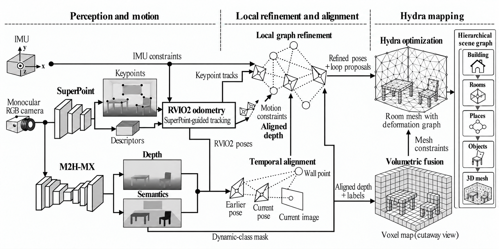
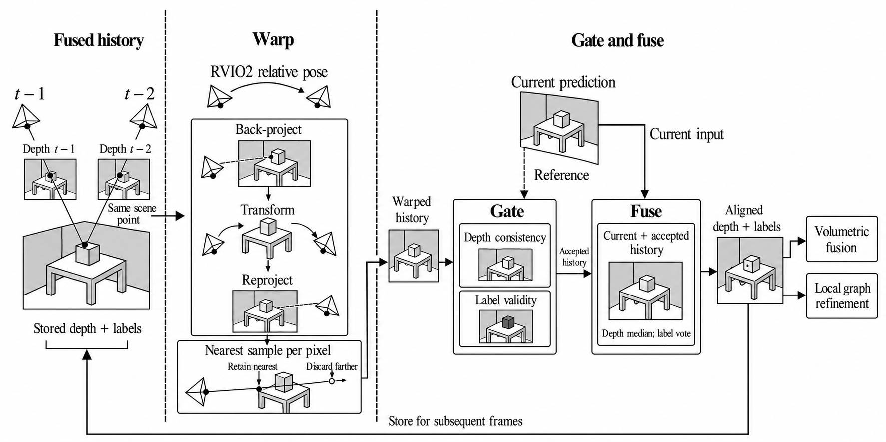
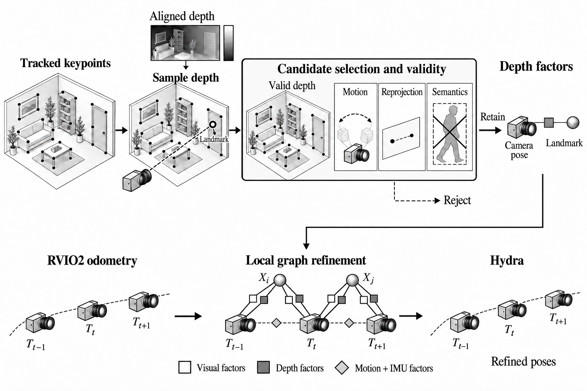
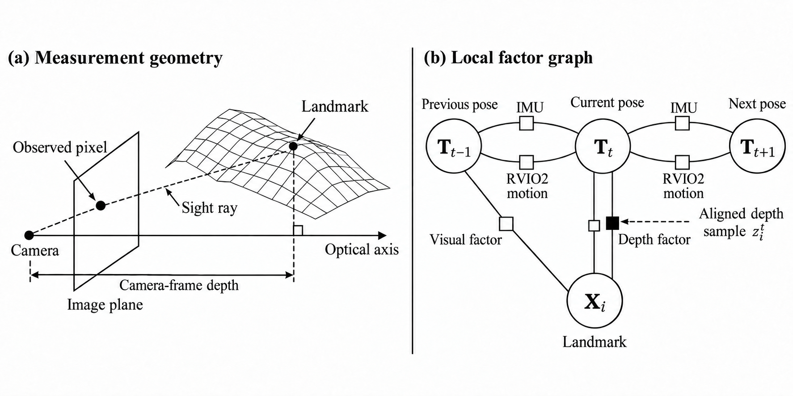

<div align="center">

# Mono Hydra++

**Monocular 3D scene graphs from RGB and IMU**

ROS 2 Jazzy · RVIO2–SuperPoint · M2H perception · Hydra mapping

[Journal figures](#journal-method-figures) · [ITC quick start](ITC_REVISION.md) · [SuperPoint setup](mono_hydra_vio/README.md#rvio2-sp-superpoint-guided-tracking) · [PTC on/off](ITC_REVISION.md#switch-ptc-on-or-off) · [License](LICENSE)

</div>

Mono Hydra++ turns monocular RGB and IMU observations into a semantic mesh and
a layered 3D scene graph. The revised ITC flow uses SuperPoint dense tracking
inside R-VIO2, learned metric depth and semantics from M2H, and Kimera loop
proposals consumed by the MIT SPARK Hydra backend.

[](images/system_overview_journal_v14.png)

*System overview from the revised journal manuscript. Click the figure for full
resolution. The [ITC guide](ITC_REVISION.md) specifies the active components and
optional switches for the published launch preset.*

## First-review ITC update

This source update brings the ITC full-loop implementation and its shared
perception, VIO, and mapping dependencies into the public repository.
The [ITC revision guide](ITC_REVISION.md) contains the complete two-terminal
command, model setup links, optional switches, and validation scope.

| Main flow | Optional tests and fallbacks |
| --- | --- |
| RVIO2–SuperPoint dense tracking | Classical RVIO2 with `rvio2_variant:=classical` |
| M2H-HMX depth and semantics | Additional perception backends remain available |
| Kimera visual LCD → Hydra PGMO | Separate Hydra LCD switch for ablations |
| Robust TSDF integration | Geometric reliability and temporal object association |
| Raw M2H depth into Hydra | PTC refinement, disabled by default |

<details>
<summary>ITC runtime flow and optional PTC branch</summary>

```mermaid
flowchart LR
    camera[RGB + IMU] --> vio[RVIO2 + SuperPoint]
    camera --> perception[M2H depth + semantics]
    vio --> kimera[Kimera pose graph + visual LCD]
    perception --> kimera
    perception --> hydra[Hydra + PGMO]
    kimera --> hydra
    perception -. Optional PTC refinement .-> ptc[Pose-guided depth correction]
    vio -. Camera pose .-> ptc
    ptc -. Replaces raw depth input when enabled .-> hydra
    hydra --> mesh[Semantic mesh]
    hydra --> graph[Objects · Places · Rooms · Building]
```

</details>

## Journal method figures

The figures below illustrate temporal alignment, depth-sample selection, and
local depth-factor geometry in the revised manuscript. The current ITC
quick-start preset disables temporal alignment and sparse depth factors.
[Optional PTC refinement](ITC_REVISION.md#switch-ptc-on-or-off) is a separate
path and remains off by default.

<details>
<summary><strong>Temporal alignment</strong> — warp, gate, and fuse depth and labels</summary>

[](images/temporal_alignment_journal_v14.png)

*Historical observations are back-projected, transformed, and reprojected into
the current image. Accepted history is combined with the current prediction.*

</details>

<details>
<summary><strong>Depth sampling</strong> — select measurements for local graph refinement</summary>

[](images/depth_sampling_journal_v5.png)

*Candidate depth samples are checked before entering the local graph alongside
visual, motion, and IMU constraints.*

</details>

<details>
<summary><strong>Depth-factor geometry</strong> — connect a camera-frame measurement to a landmark</summary>

[](images/depth_factor_geometry_journal_v3.png)

*The measurement diagram relates the observed pixel and landmark to camera-frame
depth; the graph shows how that sample connects the current pose and landmark.*

</details>

## Repository Layout

```text
mono_hydra              launch, dataset mappings, Hydra wiring, RViz
mono_hydra_vio          custom R-VIO2 + pose-graph/LCD VIO module
mono_hydra_perception   M2H-HMX-Large PyTorch/ONNX perception interface
mono_hydra_utils        vendored Hydra, Spark-DSG, Kimera-PGMO/RPGO, tools
images                  paper and README figures
```

This repository is intended to be cloned as the `src/` directory of a ROS 2
workspace:

```bash
mkdir -p ~/mono_hydra_ros2_ws
cd ~/mono_hydra_ros2_ws
git clone https://github.com/BavanthaU/mono-hydra-pp.git src
```

Third-party source is vendored under `mono_hydra_utils`; no Git submodules are required.
The recorded upstream revisions are listed in [UPSTREAM_REPOS.md](UPSTREAM_REPOS.md).

## Pipeline

```text
RGB + IMU
  -> R-VIO2 + SuperPoint dense tracking
  -> /rvio2/trajectory
  -> /external_odometry and /mono_hydra_vio/odometry
  -> mono_hydra_vio RGB-D/external-odometry pose graph
  -> loop-closure proposals following the Kimera LCD formulation
  -> Hydra GraphBuilder + Kimera-PGMO/Kimera-RPGO backend
  -> optimized mesh, rooms, objects, places, building, and 3D scene graph
```

The perception package publishes learned metric depth and semantic label IDs:

```text
/camera/depth_cam/image_raw        sensor_msgs/Image, 32FC1
/camera/seg_cam/labels_argmax      sensor_msgs/Image, mono8
/mono_hydra_perception/synced/*    RGB/CameraInfo paired with each prediction
```

## Model Weights

Model checkpoints and ONNX exports are not included in the public repository.
They are ignored by `.gitignore` to keep the journal-submission repository small
and redistributable.

Place local checkpoints under these paths inside this repository:

```text
mono_hydra_perception/weights/
mono_hydra_perception/onnx_models/
```

or pass them explicitly:

```bash
ros2 launch mono_hydra mono_hydra_itc_rosbag.launch.py \
  perception_backend:=torch perception_checkpoint_path:=/path/to/m2h_hmx_large.pt
```

Loop-closure detection also needs the ORB vocabulary installed locally. The
archive and expanded vocabulary are intentionally ignored by Git:

```bash
src/mono_hydra_vio/scripts/download_orb_vocabulary.sh
```

## Build

The revised ITC flow uses RVIO2–SuperPoint. Complete its
[model and ONNX Runtime setup](mono_hydra_vio/README.md#rvio2-sp-superpoint-guided-tracking)
before building. For a classical-only build, pass
`--cmake-args -DMONO_HYDRA_BUILD_RVIO2_SP=OFF` and use
`rvio2_variant:=classical` when launching.

Use a modest build load for workstation thermals:

```bash
cd ~/mono_hydra_ros2_ws
source /opt/ros/jazzy/setup.bash
rosdep install --from-paths src src/mono_hydra_perception/mavista --ignore-src -r -y
MAKEFLAGS="-j2" colcon build --base-paths src src/mono_hydra_perception/mavista \
  --symlink-install --continue-on-error \
  --parallel-workers 2
source install/setup.bash
```

## ITC Full-Loop Run

Convert the ROS 1 ITC bag once:

```bash
src/mono_hydra_utils/mono_hydra_utils/scripts/convert_itc_ros1_bag_to_ros2.sh \
  /path/to/ITC_2nd_floor_full_loop.bag
```

Terminal 1:

```bash
cd ~/mono_hydra_ros2_ws
source install/setup.bash
ros2 launch mono_hydra mono_hydra_itc_rosbag.launch.py \
  sequence_name:=itc_full_loop use_rviz:=true perception_backend:=torch \
  rvio2_variant:=superpoint use_ptc_refinement:=false
```

Terminal 2:

```bash
cd ~/mono_hydra_ros2_ws
source install/setup.bash
ros2 bag play test_data/itc_ros2_bags/ITC_2nd_floor_full_loop_ros2 \
  --clock --qos-profile-overrides-path \
  "$(ros2 pkg prefix mono_hydra_utils)/share/mono_hydra_utils/config/tf_overrides.yaml" \
  --remap /tf:=/tf_ignore /tf_static:=/tf_static_ignore
```

The reference runs use normal bag timing. ONNX inference remains available only
when explicitly requested:

```bash
ros2 launch mono_hydra mono_hydra_itc_rosbag.launch.py \
  perception_backend:=onnx onnx_model_path:=/path/to/model.onnx
```

## Other Dataset Launches

```bash
ros2 launch mono_hydra mono_hydra_7scenes.launch.py \
  use_rviz:=true perception_backend:=torch

ros2 launch mono_hydra mono_hydra_uhumans.launch.py \
  use_rviz:=true perception_backend:=torch use_sparse_depth_factors:=true

ros2 launch mono_hydra mono_hydra_scannet.launch.py \
  use_rviz:=true perception_backend:=torch
```

Useful ablation switches:

```text
use_sparse_depth_factors
use_semantic_masking
superpoint_keypoint_mask_topic
use_temporal_alignment
kimera_do_coarse_imu_camera_temporal_sync
kimera_do_fine_imu_camera_temporal_sync
```

## License

The original Mono Hydra ROS 2 integration code in this repository is released
under the MIT License; see [LICENSE](LICENSE). This does not relicense vendored
upstream code. MIT SPARK Hydra and the other third-party projects under
`mono_hydra_utils`, plus R-VIO2/vocabulary-derived components under
`mono_hydra_vio`, retain their upstream licenses. See
[THIRD_PARTY_NOTICES.md](THIRD_PARTY_NOTICES.md) and the license files in each
vendored source directory.

## Acknowledgements

This work builds on major open-source robotics systems:

- MIT SPARK Hydra and Hydra-ROS: https://github.com/MIT-SPARK/Hydra and
  https://github.com/MIT-SPARK/Hydra-ROS. Cite Hughes et al., “Hydra: A
  Real-time Spatial Perception System for 3D Scene Graph Construction and
  Optimization,” RSS, 2022.
- Kimera, Kimera-PGMO, and Kimera-RPGO:
  https://github.com/MIT-SPARK/Kimera-VIO,
  https://github.com/MIT-SPARK/Kimera-PGMO, and
  https://github.com/MIT-SPARK/Kimera-RPGO. The `mono_hydra_vio` pose-graph and
  loop-closure implementation follows the Kimera formulation; cite Rosinol et
  al., “Kimera: an Open-Source Library for Real-Time Metric-Semantic
  Localization and Mapping,” ICRA, 2020, and Rosinol et al., “Kimera: From SLAM
  to Spatial Perception with 3D Dynamic Scene Graphs,” IJRR, 2021.
- R-VIO / R-VIO2: https://github.com/rpng/R-VIO. Cite Huai and Huang,
  “Robocentric Visual-Inertial Odometry,” IJRR, and the square-root R-VIO2
  online spatiotemporal calibration work where applicable.
- GTSAM: https://github.com/borglab/gtsam. Cite Dellaert, “Factor Graphs and
  GTSAM: A Hands-on Introduction,” 2012.

## Bibliography and citation

If you use this repository, please cite Mono-Hydra++ and the relevant perception
and mapping papers below, alongside the upstream systems acknowledged above.

1. **Mono-Hydra++** — U. V. B. L. Udugama, George Vosselman, and Francesco Nex.
   *Mono-Hydra++: Real-Time Monocular Scene Graph Construction with Multi-Task
   Learning for 3D Indoor Mapping.* 2026. Under review at the **ISPRS Journal of
   Photogrammetry and Remote Sensing**; revised manuscript submitted following
   the first review cycle. [Paper](https://arxiv.org/abs/2605.17661).

2. **M2H-MX** — U. V. B. L. Udugama, George Vosselman, and Francesco Nex.
   *M2H-MX: Multi-Task Semantic and Geometric Perception for Real-Time Monocular
   3D Scene Graph Construction.* **ICRA 2026, SRRA Workshop**, 2026 (accepted).
   [Publication details](https://bavanthau.github.io/publications/)
   · [Paper](https://arxiv.org/abs/2603.29236).

3. **M2H** — U. V. B. L. Udugama, George Vosselman, and Francesco Nex.
   *M2H: Multi-Task Learning with Efficient Window-Based Cross-Task Attention
   for Monocular Spatial Perception.* **IEEE/RSJ International Conference on
   Intelligent Robots and Systems (IROS)**, 2025.
   [DOI](https://doi.org/10.1109/IROS60139.2025.11246974)
   · [Paper](https://arxiv.org/abs/2510.17363).

4. **Mono-Hydra** — U. V. B. L. Udugama, G. Vosselman, and F. Nex.
   *Mono-Hydra: Real-Time 3D Scene Graph Construction from Monocular Camera
   Input with IMU.* **ISPRS Annals of the Photogrammetry, Remote Sensing and
   Spatial Information Sciences**, X-1/W1-2023, 439–445, 2023.
   [DOI](https://doi.org/10.5194/isprs-annals-X-1-W1-2023-439-2023)
   · [Paper](https://arxiv.org/abs/2308.05515).

<details>
<summary><strong>BibTeX — copy the relevant entries</strong></summary>

```bibtex
@unpublished{udugama2026monohydrapp,
  title         = {{Mono-Hydra++}: Real-Time Monocular Scene Graph Construction with Multi-Task Learning for {3D} Indoor Mapping},
  author        = {Udugama, U. V. B. L. and Vosselman, George and Nex, Francesco},
  year          = {2026},
  note          = {Under review at ISPRS Journal of Photogrammetry and Remote Sensing},
  eprint        = {2605.17661},
  archivePrefix = {arXiv},
  primaryClass  = {cs.RO},
  doi           = {10.48550/arXiv.2605.17661},
  url           = {https://arxiv.org/abs/2605.17661}
}

@inproceedings{udugama2026m2hmx,
  title         = {{M2H-MX}: Multi-Task Semantic and Geometric Perception for Real-Time Monocular {3D} Scene Graph Construction},
  author        = {Udugama, U. V. B. L. and Vosselman, George and Nex, Francesco},
  booktitle     = {IEEE International Conference on Robotics and Automation (ICRA), SRRA Workshop},
  year          = {2026},
  note          = {Accepted},
  eprint        = {2603.29236},
  archivePrefix = {arXiv},
  url           = {https://arxiv.org/abs/2603.29236}
}

@inproceedings{udugama2025m2h,
  title         = {{M2H}: Multi-Task Learning with Efficient Window-Based Cross-Task Attention for Monocular Spatial Perception},
  author        = {Udugama, U. V. B. L. and Vosselman, George and Nex, Francesco},
  booktitle     = {2025 IEEE/RSJ International Conference on Intelligent Robots and Systems (IROS)},
  year          = {2025},
  doi           = {10.1109/IROS60139.2025.11246974},
  eprint        = {2510.17363},
  archivePrefix = {arXiv},
  url           = {https://doi.org/10.1109/IROS60139.2025.11246974}
}

@article{udugama2023monohydra,
  title   = {{Mono-Hydra}: Real-Time {3D} Scene Graph Construction from Monocular Camera Input with {IMU}},
  author  = {Udugama, U. V. B. L. and Vosselman, G. and Nex, F.},
  journal = {ISPRS Annals of the Photogrammetry, Remote Sensing and Spatial Information Sciences},
  volume  = {X-1/W1-2023},
  pages   = {439--445},
  year    = {2023},
  doi     = {10.5194/isprs-annals-X-1-W1-2023-439-2023},
  url     = {https://doi.org/10.5194/isprs-annals-X-1-W1-2023-439-2023}
}
```

</details>
